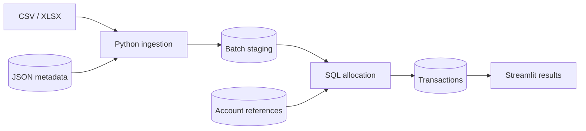
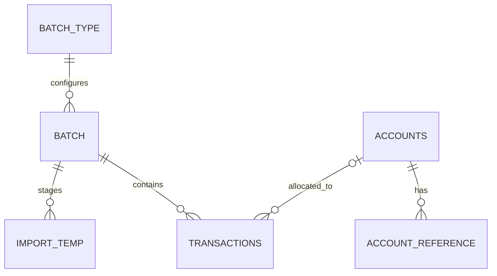

# Metadata-Driven Receipt Processing Engine

A compact financial ETL demonstration built with Python, Pandas and SQL Server. Different statement formats are processed by one ingestion engine, with account allocation performed in SQL using ranked current and historical references.

This is a standalone portfolio implementation with fictional accounts, synthetic statements and generic matching rules. It does not connect to live financial systems.

## Problem and approach

Financial files often differ in headers, delimiters, column names and transaction conventions. Instead of maintaining a parser for each bank, store the file configuration as JSON in SQL Server. Python reads and standardises the file; SQL stages and allocates the transactions.



## Run locally

Requires Docker with Compose and an x86-64 host supported by the SQL Server Linux image. On Windows, use Docker Desktop with Linux containers. From the repository root:

```bash
cp .env.example .env
# PowerShell alternative: Copy-Item .env.example .env
# Edit .env to choose a local demo password.
docker compose up --build
```

Open http://localhost:8501. SQL Server is not exposed to the host; the UI binds to localhost. The initialization service creates the database, schema, procedure and sample configurations. For startup troubleshooting, run `docker compose logs db init app`.

Select a configuration, upload its corresponding file from `samples/`, inspect the normalized preview, and click **Import and allocate**.

| Configuration | File | Expected outcome |
|---|---|---|
| Standard CSV | `standard.csv` | 2 allocated, 1 ambiguous, 1 unmatched |
| Validated bank CSV | `bank_statement.csv` | 2 allocated |
| Excel payment report | `payment_report.xlsx` | 1 allocated; zero row and footer excluded |
| Custom delimited CSV | `custom_format.csv` | 1 allocated, 1 unmatched |

Stop with `docker compose down`. To reset all demo data, use `docker compose down -v` (deletes the demo database volume).

## Metadata contract

Configurations live in `dbo.batch_type.[json]`. See `samples/configurations.json` for readable copies and `sql/seed.sql` for the database seed.

```json
{
  "structure": {
    "format": "csv",
    "start_row": 1,
    "trailing_rows": 0,
    "delimiter": ",",
    "text_identifier": "\"",
    "validate_location": null,
    "validate_value": null
  },
  "mappings": {
    "eff_date": "Date",
    "desc": "Description",
    "account": "Reference",
    "amount": "Amount"
  },
  "exceptions": {
    "password_protected": false,
    "row_exclusions": null,
    "dr_trans": ">0",
    "cr_trans": "<0"
  }
}
```

- `start_row` is the one-based header row; `trailing_rows` counts footer rows. Validation checks for a substring in a specified one-based raw row.
- Named columns (`Reference`), one-based positions (`(3)`), literal values (`{Payment}`), templates (`{Payment [Note]}`), `{now}` and ordered fallback lists are supported.
- Dates default to ISO 8601; optional `mappings.date_format` accepts Python strptime formats, such as `%d/%m/%Y`.
- Amounts accept decimal points, comma grouping, R/$ prefixes and parentheses for negatives. A fallback list selects the first nonblank value, not a sum; input columns must already encode their signs.
- Row exclusions compare trimmed text against the configured value. Debit/credit rules classify positive and negative amounts, retaining their original signs in the batch totals.
- References are preserved as text; a generic ten-digit account number is extracted from the reference or description. SQL can also match the complete reference against aliases.

### Add a format without changing Python

Connect to the running database using the bundled SQL command-line tool:

```bash
docker compose exec db bash -c '/opt/mssql-tools18/bin/sqlcmd -S localhost -U sa -P "$MSSQL_SA_PASSWORD" -C -d ReceiptDemo'
```

Insert a new configuration (the same sample schema, with a semicolon delimiter):

```sql
INSERT dbo.batch_type (description, [json])
SELECT N'New semicolon statement', JSON_MODIFY([json], '$.structure.delimiter', ';')
FROM dbo.batch_type WHERE description = N'Standard CSV';
GO
```

Create a file `new.csv` containing:

```csv
Date;Description;Reference;Amount
2026-01-01;Demo payment;OLD001;-100
```

Refresh the app, choose the new configuration and upload the file. The expected match is account `1000000001` via its legacy reference. No Python or stored procedure changes are necessary for formats within the supported metadata contract.

## Database design



`sql/schema.sql` contains keys, foreign keys, JSON and status constraints, and indexes. `sql/procedures.sql` contains the allocation procedure. References are normalized into a separate table rather than hardcoded into multiple account columns.

The procedure ranks candidates by configured priority. Current references have priority 1, legacy 2 and external 3 in the sample data. A unique best account is allocated; a tie between different accounts is flagged as ambiguous instead of guessing. Unknown references remain unmatched. The Python database layer inserts a batch, stages rows and executes the procedure within one transaction; staging is isolated by batch ID. Parameters are bound rather than interpolated into SQL.

## Repository guide

| Path | Responsibility |
|---|---|
| `ingestion.py` | Pure file reading, mapping, validation, transformation and reference extraction |
| `database.py` | Metadata lookup and atomic SQL import |
| `app.py` | Minimal single-page demonstration |
| `sql/` | Reproducible schema, allocation procedure and seed data |
| `samples/` | Fictional files and matching configurations |


## Scope and trade-offs

This is a code-focused demo, not a production receipt processing product. It deliberately omits authentication, external posting, GL allocation, archives, encrypted workbooks, legacy XLS and manual allocation. It reads files in memory, uses a local privileged database login for convenience, and does not deduplicate repeated uploads across batches. Same-batch repeat processing is guarded by the SQL procedure. Production extensions would include access control, resource limits, metadata schema validation/versioning, secrets management, auditing and idempotency keys.

The simplified design uses decimal arithmetic, generic account references, batch-specific staging and explicit ambiguous matches. These are portfolio design choices, not a claim that an existing production implementation uses them.
